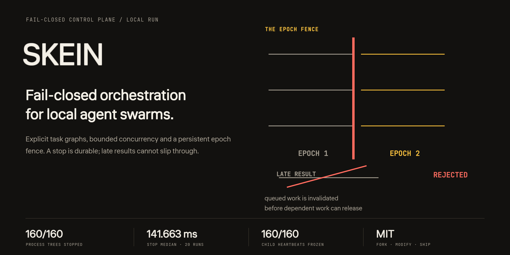
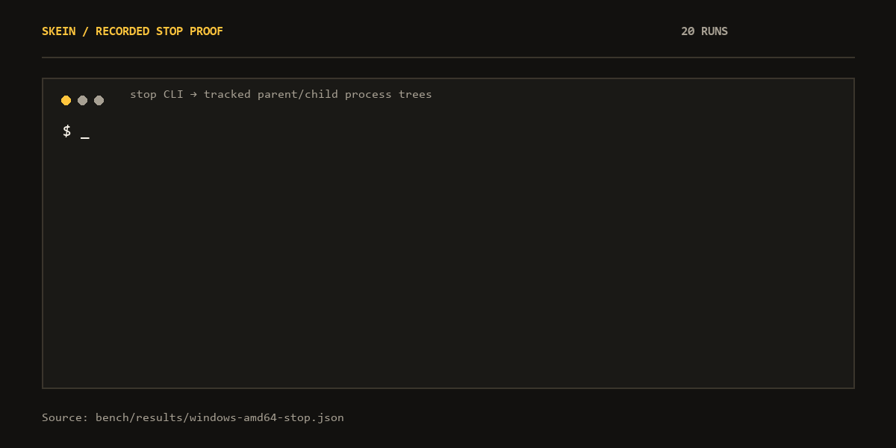
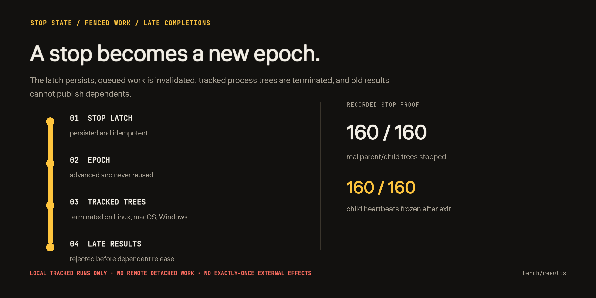

<div align="center">
  
  <p><strong>Fail-closed orchestration for local agent swarms.</strong></p>
  <p>Explicit task graphs · bounded concurrency · persistent epoch fence · MIT</p>
  <p>
    <a href="#install">Install</a> ·
    <a href="#run">Run</a> ·
    <a href="#what-the-stop-does--and-what-it-does-not">Stop boundary</a> ·
    <a href="#measurements">Measurements</a> ·
    <a href="BENCHMARKS.md">Benchmarks</a> ·
    <a href="https://balanov.pro/skein/">Website</a> ·
    <a href="README_RU.md">Русский</a>
  </p>
  <p>
    <a href="https://github.com/Balanov/skein/actions/workflows/ci.yml"></a>
    <a href="https://github.com/Balanov/skein/releases/latest"></a>
    <a href="LICENSE"></a>
    <a href="go.mod"></a>
  </p>
</div>

<div align="center">
  
  <p><sub>Recorded stop proof from <a href="bench/results/windows-amd64-stop.json">windows-amd64-stop.json</a> · 20 runs · <a href="bench/README.md">Reproduce the proof</a>.</sub></p>
</div>

Skein executes explicit task graphs with bounded concurrency and a persistent **epoch fence**. An emergency stop invalidates queued work and rejects late completions from the old epoch instead of merely labeling a task canceled.

Independent open-source project by [Paritet](https://paritet.dev/). Skein is an execution control plane, not an agent framework or a model runtime. Version 0.2.0 is an early release: exercise the stop proof against your own workloads before relying on it operationally.

[Architecture](docs/ARCHITECTURE.md) · [Security boundary](SECURITY.md) · [Integration](docs/INTEGRATION.md) · [Benchmarks](BENCHMARKS.md) · [Landing source](site/) · [Website](https://balanov.pro/skein/)

## Install

Linux and macOS:

```sh
curl -fsSL https://raw.githubusercontent.com/Balanov/skein/main/install.sh | sh
```

Windows PowerShell:

```powershell
irm https://raw.githubusercontent.com/Balanov/skein/main/install.ps1 | iex
```

Both scripts pick the binary for the current OS and architecture (Linux, macOS, Windows × amd64, arm64), verify it against `SHA256SUMS` and install into a user directory. Set `SKEIN_INSTALL_DIR` to override. Alternatively, download binaries from [releases](https://github.com/Balanov/skein/releases/latest) or build from source with Go 1.26+:

```sh
go build -trimpath -o bin/skein ./cmd/skein
```

The binary is static, needs no daemon, database or runtime dependencies.

## Run

```sh
skein run --state .skein --workers 2 --include-tasks examples/fanout.json
skein stop --state .skein --reason "manual emergency stop"
skein status --state .skein   # {"stopped":true,"epoch":2}
skein reset --state .skein    # inspect first; epoch is never reused
```

A run stores `report.json`, `events.jsonl`, leases and payload data under `.skein/runs/<run-id>/`. Exit codes: `0` success, `3` a task failed, `4` the run was stopped, `1` operational error, `2` usage error.

Manifests are JSON: argv arrays without an implicit shell, dependency graphs, reusable multi-pass blocks, worker and pass limits, per-pass timeouts. See [docs/INTEGRATION.md](docs/INTEGRATION.md) for the full contract and the Go embedding API (`import skein "github.com/Balanov/skein"`, runnable example in `examples/embed-go/`).

## What the stop does — and what it does not

**Covered:** scheduling within one local run; a persistent idempotent stop latch; epoch-fenced queued work; rejection of late completions; termination of tracked local process trees on Linux, macOS and Windows.

**Not covered:** sandboxing arbitrary commands; authentication or signed leases; semantic validation of agent output; exactly-once external side effects; automatic crash recovery; distributed consensus; remote or detached work, and side effects that already crossed an external boundary.

A lease is a fencing token, not a credential — external systems honor it only through a gateway that checks it. Manifest commands keep the OS user's permissions; use an OS sandbox for untrusted workloads. See [SECURITY.md](SECURITY.md).

<div align="center">
  
  <p><sub>The stop changes scheduling state; it does not create a sandbox, remote stop, or exactly-once external-effect guarantee. <a href="docs/ARCHITECTURE.md">Full architecture</a> · <a href="SECURITY.md">Security boundary</a>.</sub></p>
</div>

## Measurements

Recorded on Windows 11 / Ryzen 9 5950X; each warm result is the median of 15 interleaved samples on identical graphs.

| 1,000-node graph | Skein | Python asyncio | LangGraph |
| --- | ---: | ---: | ---: |
| Independent | **1.580 ms** | 3.530 ms | 876.910 ms |
| Serial chain | **3.272 ms** | 4.479 ms | 534.907 ms |
| Fan-out / join | **2.080 ms** | 3.795 ms | 892.522 ms |

A separate cold-process test launched 24 real Python SHA-256 workers per run. Over 15 fresh-process runs, Skein's median was **156.463 ms** versus **288.644 ms** for asyncio and **998.010 ms** for LangGraph, with **360 / 360 results verified for every candidate**. The stop proof terminated **160 / 160 real parent/child trees** and froze **160 / 160 child heartbeats** in **141.663 ms** median over 20 runs.

Skein is not ahead everywhere: at 100 independent tasks asyncio had a lower median (**0.740 ms versus 1.040 ms**). These are local observations, not universal rankings or model-quality results. Full methodology, p95, scaling and reproduction commands: [BENCHMARKS.md](BENCHMARKS.md).

## Checks

```sh
go test -count=1 ./...
go vet ./...
go test -race -count=1 ./... # requires CGO and a C compiler
```

CI runs formatting, tests, vet, the Linux race detector, six cross-compile targets, the frontend build, and real functional plus parent/child stop proofs on six native runners (Linux, Windows, macOS × amd64, arm64). Tagged releases build each binary on its native platform and re-run both proofs per binary before publishing.

## License

MIT © 2026 Balanov. Machine-readable citation: [CITATION.cff](CITATION.cff).
