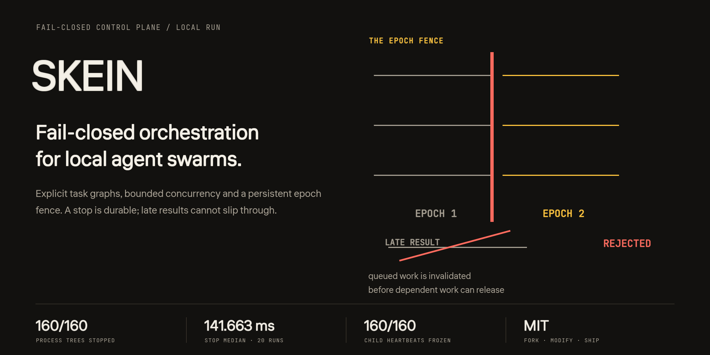
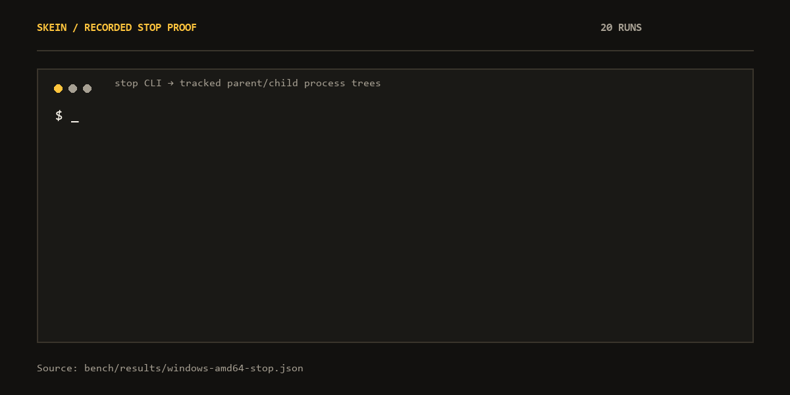
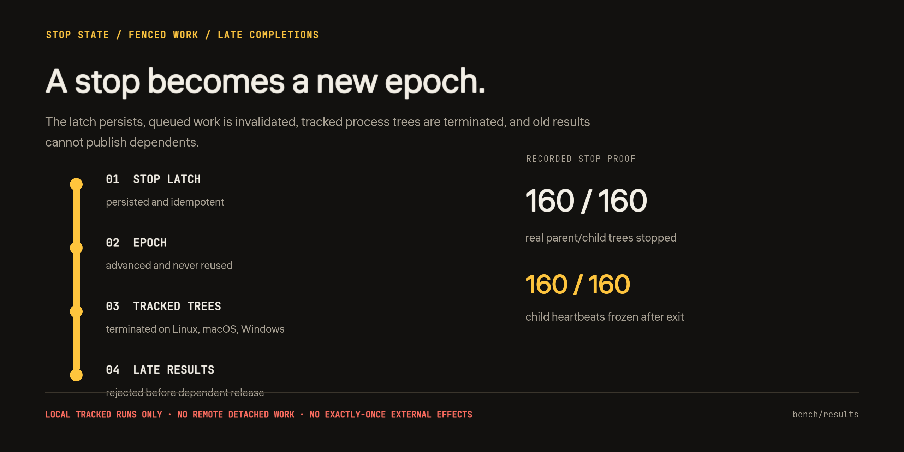

<div align="center">
  
  <p><strong>Fail-closed оркестрация локальных agent swarms.</strong></p>
  <p><a href="README.md">English</a> · <a href="#установка">Установка</a> · <a href="#запуск">Запуск</a> · <a href="#что-делает-stop">Граница stop</a> · <a href="#измерения">Измерения</a> · <a href="https://balanov.pro/skein/">Сайт</a></p>
</div>

Краткое русское введение. Полная документация, интеграция, архитектура и воспроизведение проверок — в [английском README](README.md).

## Что делает Skein

Skein выполняет явные графы задач с ограниченной параллельностью и постоянным **epoch fence**. Аварийная остановка не просто помечает задачу как отменённую: stop latch сохраняется, очередная работа старого epoch отменяется, отслеживаемые локальные деревья процессов завершаются, а поздний результат не может запустить зависимые задачи.

Skein — execution control plane, а не agent framework, модельный runtime, sandbox или distributed consensus. Версия 0.2.0 ранняя: перед эксплуатационным доверием прогоните stop proof на собственных рабочих нагрузках.

<div align="center">
  
  <p><sub>Записанные результаты из <a href="bench/results/windows-amd64-stop.json">windows-amd64-stop.json</a>, 20 прогонов.</sub></p>
</div>

## Установка

Linux и macOS:

```sh
curl -fsSL https://raw.githubusercontent.com/Balanov/skein/main/install.sh | sh
```

Windows PowerShell:

```powershell
irm https://raw.githubusercontent.com/Balanov/skein/main/install.ps1 | iex
```

Установщики выбирают бинарник под ОС и архитектуру, проверяют `SHA256SUMS` и устанавливают файл в пользовательский каталог. `SKEIN_INSTALL_DIR` меняет место установки. Готовые релизы — в [Releases](https://github.com/Balanov/skein/releases/latest). Для сборки нужен Go 1.26+:

```sh
go build -trimpath -o bin/skein ./cmd/skein
```

Бинарник статический и не требует daemon, базы данных или runtime-зависимостей.

## Запуск

```sh
skein run --state .skein --workers 2 --include-tasks examples/fanout.json
skein stop --state .skein --reason "manual emergency stop"
skein status --state .skein   # {"stopped":true,"epoch":2}
skein reset --state .skein    # inspect first; epoch is never reused
```

Один запуск хранит `report.json`, `events.jsonl`, lease и payload-файлы в `.skein/runs/<run-id>/`. Коды выхода: `0` успех, `3` упавшая задача, `4` остановленный запуск, `1` операционная ошибка, `2` ошибка использования.

Манифесты — JSON: argv-массивы без неявного shell, dependency graph, многопроходные блоки, лимиты workers и passes, timeout для каждого pass. Полный контракт и Go API — в [docs/INTEGRATION.md](docs/INTEGRATION.md), работающий пример — в `examples/embed-go/`.

## Что делает stop

**Покрывается:**

- локальное планирование в одном запуске;
- постоянный и идемпотентный stop latch;
- epoch-fenced очередная работа;
- отклонение поздних завершений;
- завершение отслеживаемых локальных деревьев процессов на Linux, macOS и Windows.

**Не покрывается:**

- sandbox произвольных команд;
- аутентификация или подписанные lease;
- семантическая проверка вывода агента;
- exactly-once внешние side effects;
- автоматическое восстановление после сбоя;
- distributed consensus;
- remote/detached работа и эффекты, уже пересёкшие внешнюю границу.

Lease — fencing token, а не credential. Внешняя система уважает его только через gateway, который проверяет epoch. Команды манифеста получают права пользователя ОС; для недоверенных workload используйте OS sandbox. Подробности — в [SECURITY.md](SECURITY.md).

<div align="center">
  
</div>

## Измерения

Записано на Windows 11 / Ryzen 9 5950X; тёплые результаты — медианы 15 чередующихся прогонов на одинаковых графах.

| Граф на 1 000 узлов | Skein | Python asyncio | LangGraph |
| --- | ---: | ---: | ---: |
| Независимые задачи | **1.580 мс** | 3.530 мс | 876.910 мс |
| Последовательная цепочка | **3.272 мс** | 4.479 мс | 534.907 мс |
| Fan-out / join | **2.080 мс** | 3.795 мс | 892.522 мс |

Отдельный cold-process тест запускал 24 реальных Python SHA-256 worker на прогон. За 15 запусков медиана Skein составила **156.463 мс** против **288.644 мс** у asyncio и **998.010 мс** у LangGraph; все **360 / 360 результатов** каждого кандидата проверены. Stop proof завершил **160 / 160 реальных parent/child деревьев** и заморозил **160 / 160 child heartbeats**; медиана — **141.663 мс** за 20 прогонов.

Skein не везде быстрее: на 100 независимых задачах asyncio показал меньшую медиану — **0.740 мс против 1.040 мс**. Это локальные наблюдения, а не универсальные рейтинги и не результат качества модели. Методология, p95, масштабирование и команды воспроизведения — в [BENCHMARKS.md](BENCHMARKS.md).

## Проверки

```sh
go test -count=1 ./...
go vet ./...
go test -race -count=1 ./... # требует CGO и C-компилятор
```

CI проверяет форматирование, тесты, vet, Linux race detector, шесть cross-compile targets, сборку frontend, а также реальные functional и parent/child stop proofs на шести нативных runner-ах. Тегированные релизы собирают каждый бинарник на его платформе и повторяют оба proof перед публикацией.

[MIT](LICENSE) © 2026 Balanov. Машиночитаемая цитата: [CITATION.cff](CITATION.cff). Полная документация: [README.md](README.md).
